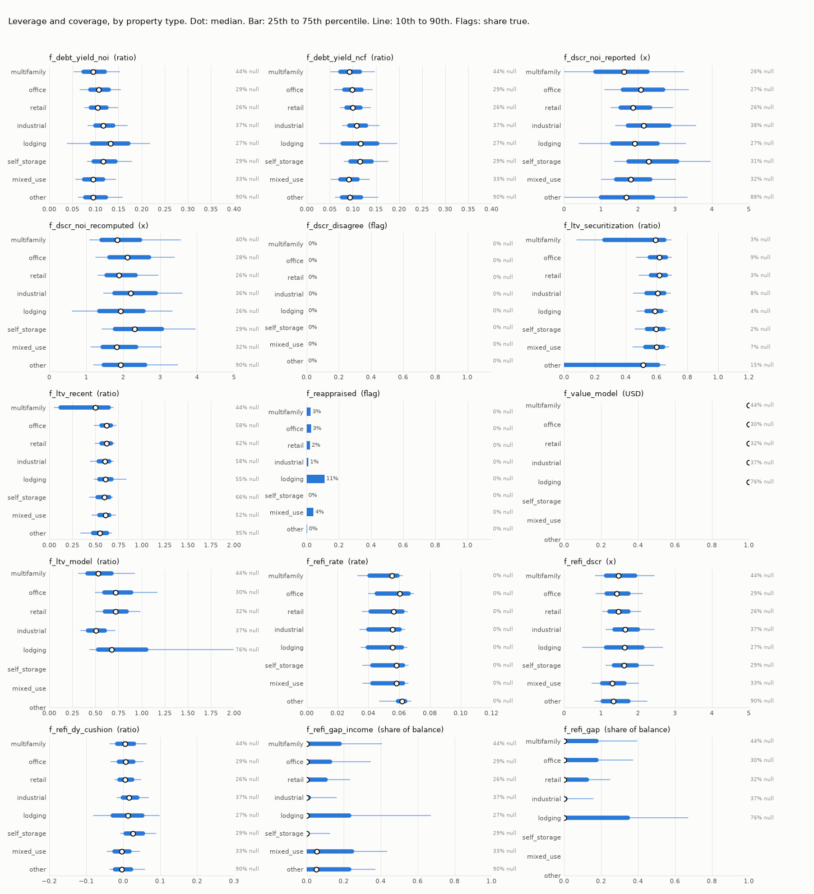
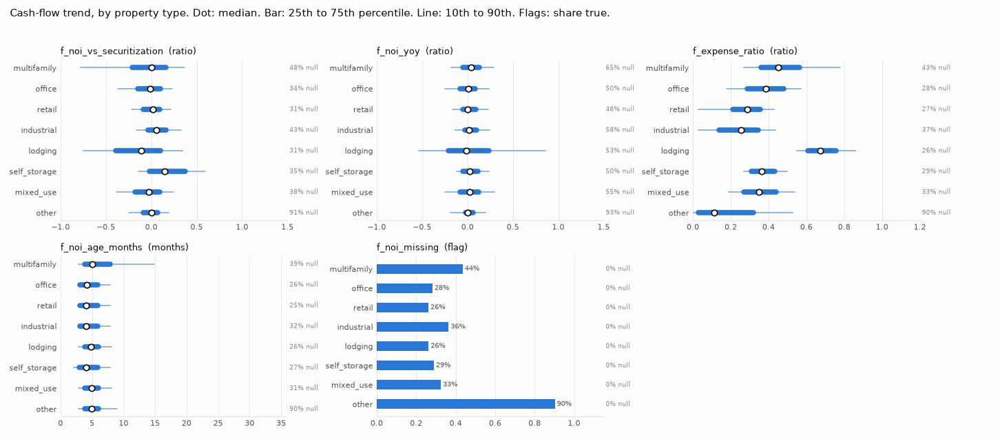
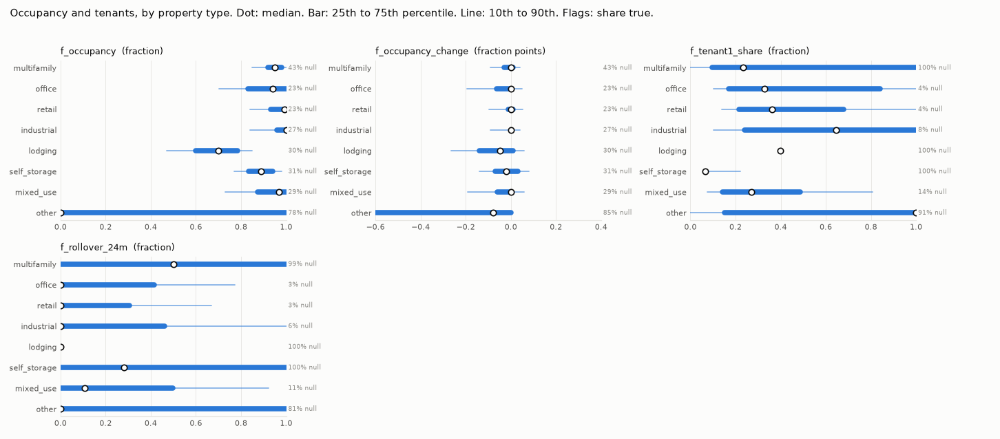
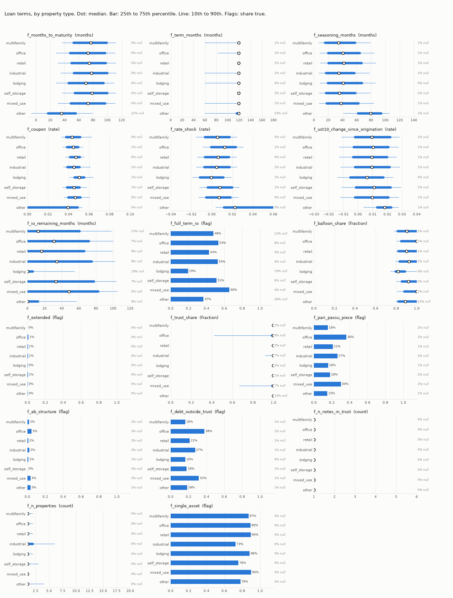
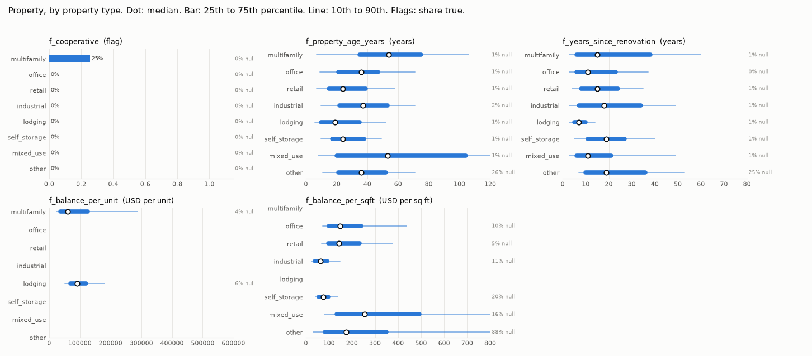
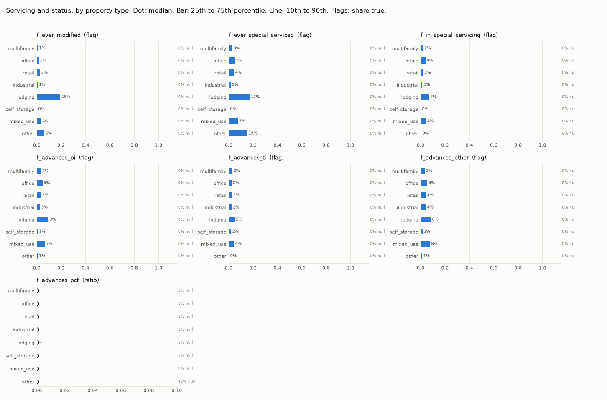
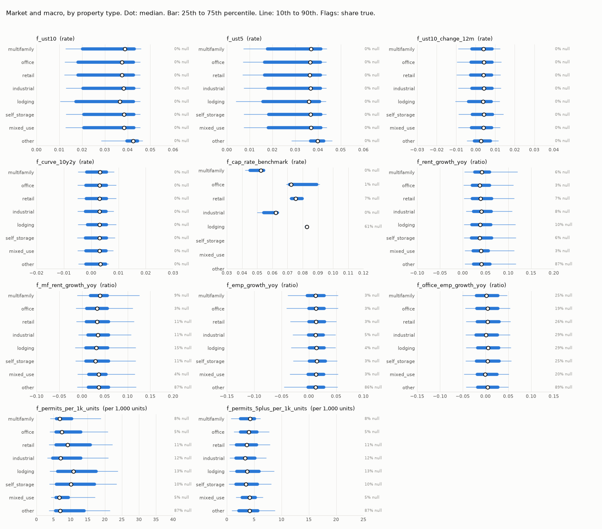

# Gate 2 features: coverage and distributions

Generated 2026-11-16 by `python -m mwall features`. Dictionary: `docs/features.md`. Rows: 1,102,379 loan-months; tables and plots use the 970,517 representative rows (one per whole loan and month).

- Late snapshots (filed more than 60 days after the period, or after the loan's next period ended): 7,229 rows, kept out of model training.
- Rows with a metro: 92.7%.

## Coverage by property type (share not null)

| feature | all | multifamily | office | retail | industrial | lodging | self_storage | mixed_use | other |
| --- | --- | --- | --- | --- | --- | --- | --- | --- | --- |
| f_debt_yield_noi | 0.63 | 0.56 | 0.71 | 0.74 | 0.63 | 0.73 | 0.71 | 0.67 | 0.10 |
| f_debt_yield_ncf | 0.63 | 0.56 | 0.71 | 0.74 | 0.63 | 0.73 | 0.71 | 0.67 | 0.10 |
| f_dscr_noi_reported | 0.68 | 0.74 | 0.73 | 0.74 | 0.62 | 0.73 | 0.69 | 0.68 | 0.12 |
| f_dscr_noi_recomputed | 0.65 | 0.60 | 0.72 | 0.74 | 0.64 | 0.74 | 0.71 | 0.68 | 0.10 |
| f_dscr_disagree | 1.00 | 1.00 | 1.00 | 1.00 | 1.00 | 1.00 | 1.00 | 1.00 | 1.00 |
| f_ltv_securitization | 0.95 | 0.97 | 0.91 | 0.97 | 0.92 | 0.96 | 0.98 | 0.93 | 0.85 |
| f_ltv_recent | 0.41 | 0.56 | 0.42 | 0.38 | 0.42 | 0.45 | 0.34 | 0.48 | 0.05 |
| f_reappraised | 1.00 | 1.00 | 1.00 | 1.00 | 1.00 | 1.00 | 1.00 | 1.00 | 1.00 |
| f_value_model | 0.46 | 0.56 | 0.70 | 0.68 | 0.63 | 0.24 | 0.00 | 0.00 | 0.00 |
| f_ltv_model | 0.46 | 0.56 | 0.70 | 0.68 | 0.63 | 0.24 | 0.00 | 0.00 | 0.00 |
| f_refi_rate | 1.00 | 1.00 | 1.00 | 1.00 | 1.00 | 1.00 | 1.00 | 1.00 | 1.00 |
| f_refi_dscr | 0.63 | 0.56 | 0.71 | 0.74 | 0.63 | 0.73 | 0.71 | 0.67 | 0.10 |
| f_refi_dy_cushion | 0.63 | 0.56 | 0.71 | 0.74 | 0.63 | 0.73 | 0.71 | 0.67 | 0.10 |
| f_refi_gap_income | 0.63 | 0.56 | 0.71 | 0.74 | 0.63 | 0.73 | 0.71 | 0.67 | 0.10 |
| f_refi_gap | 0.46 | 0.56 | 0.70 | 0.68 | 0.63 | 0.24 | 0.00 | 0.00 | 0.00 |
| f_noi_vs_securitization | 0.59 | 0.52 | 0.66 | 0.69 | 0.57 | 0.69 | 0.65 | 0.62 | 0.09 |
| f_noi_yoy | 0.43 | 0.35 | 0.50 | 0.52 | 0.42 | 0.47 | 0.50 | 0.45 | 0.07 |
| f_expense_ratio | 0.64 | 0.57 | 0.72 | 0.73 | 0.63 | 0.74 | 0.71 | 0.67 | 0.10 |
| f_noi_age_months | 0.66 | 0.61 | 0.74 | 0.75 | 0.68 | 0.74 | 0.73 | 0.69 | 0.10 |
| f_noi_missing | 1.00 | 1.00 | 1.00 | 1.00 | 1.00 | 1.00 | 1.00 | 1.00 | 1.00 |
| f_occupancy | 0.67 | 0.57 | 0.77 | 0.77 | 0.73 | 0.70 | 0.69 | 0.71 | 0.22 |
| f_occupancy_change | 0.66 | 0.57 | 0.77 | 0.77 | 0.73 | 0.70 | 0.69 | 0.71 | 0.15 |
| f_tenant1_share | 0.51 | 0.00 | 0.96 | 0.96 | 0.92 | 0.00 | 0.00 | 0.86 | 0.09 |
| f_rollover_24m | 0.53 | 0.01 | 0.97 | 0.97 | 0.94 | 0.00 | 0.00 | 0.89 | 0.19 |
| f_months_to_maturity | 0.98 | 1.00 | 1.00 | 1.00 | 1.00 | 1.00 | 1.00 | 1.00 | 0.78 |
| f_term_months | 0.97 | 0.99 | 0.99 | 0.99 | 0.99 | 1.00 | 0.98 | 0.99 | 0.77 |
| f_seasoning_months | 0.99 | 0.99 | 0.99 | 0.99 | 0.99 | 1.00 | 0.98 | 0.99 | 0.99 |
| f_coupon | 0.99 | 1.00 | 0.99 | 1.00 | 0.99 | 0.99 | 0.99 | 1.00 | 1.00 |
| f_rate_shock | 0.99 | 1.00 | 0.99 | 1.00 | 0.99 | 0.99 | 0.99 | 1.00 | 1.00 |
| f_ust10_change_since_origination | 0.99 | 0.99 | 0.99 | 0.99 | 0.99 | 1.00 | 0.98 | 0.99 | 0.99 |
| f_io_remaining_months | 0.90 | 0.87 | 0.93 | 0.91 | 0.91 | 0.81 | 0.93 | 0.95 | 0.91 |
| f_full_term_io | 0.89 | 0.88 | 0.92 | 0.91 | 0.91 | 0.81 | 0.94 | 0.96 | 0.74 |
| f_balloon_share | 0.97 | 0.99 | 0.99 | 0.99 | 0.99 | 1.00 | 0.98 | 0.99 | 0.77 |
| f_extended | 1.00 | 1.00 | 1.00 | 1.00 | 1.00 | 1.00 | 1.00 | 1.00 | 1.00 |
| f_trust_share | 0.95 | 0.98 | 0.92 | 0.97 | 0.93 | 0.96 | 0.99 | 0.93 | 0.86 |
| f_pari_passu_piece | 0.98 | 0.98 | 0.98 | 0.99 | 0.97 | 0.99 | 0.98 | 0.98 | 0.99 |
| f_ab_structure | 0.98 | 0.97 | 0.97 | 0.98 | 0.97 | 0.99 | 0.97 | 0.97 | 0.99 |
| f_debt_outside_trust | 0.99 | 0.99 | 0.99 | 0.99 | 0.99 | 1.00 | 0.99 | 0.99 | 0.99 |
| f_n_notes_in_trust | 1.00 | 1.00 | 1.00 | 1.00 | 1.00 | 1.00 | 1.00 | 1.00 | 1.00 |
| f_n_properties | 1.00 | 1.00 | 1.00 | 1.00 | 1.00 | 1.00 | 1.00 | 1.00 | 1.00 |
| f_single_asset | 1.00 | 1.00 | 1.00 | 1.00 | 1.00 | 1.00 | 1.00 | 1.00 | 1.00 |
| property_group | 0.95 | 1.00 | 1.00 | 1.00 | 1.00 | 1.00 | 1.00 | 1.00 | 0.36 |
| prop_type_code | 0.95 | 1.00 | 1.00 | 1.00 | 1.00 | 1.00 | 1.00 | 1.00 | 0.36 |
| f_cooperative | 1.00 | 1.00 | 1.00 | 1.00 | 1.00 | 1.00 | 1.00 | 1.00 | 1.00 |
| prop_state | 0.94 | 1.00 | 1.00 | 1.00 | 1.00 | 1.00 | 1.00 | 1.00 | 0.16 |
| cbsa_code | 0.92 | 0.99 | 0.99 | 0.99 | 0.97 | 0.97 | 0.99 | 0.99 | 0.14 |
| f_property_age_years | 0.97 | 0.99 | 0.99 | 0.99 | 0.98 | 0.99 | 0.99 | 0.99 | 0.74 |
| f_years_since_renovation | 0.97 | 0.99 | 1.00 | 0.99 | 0.99 | 0.99 | 0.99 | 0.99 | 0.75 |
| f_balance_per_unit | 0.30 | 0.96 | 0.00 | 0.00 | 0.00 | 0.94 | 0.00 | 0.00 | 0.00 |
| f_balance_per_sqft | 0.56 | 0.00 | 0.90 | 0.95 | 0.89 | 0.00 | 0.80 | 0.84 | 0.12 |
| delinquency_bucket | 0.96 | 0.99 | 0.99 | 1.00 | 0.99 | 0.99 | 0.99 | 1.00 | 0.59 |
| f_ever_modified | 1.00 | 1.00 | 1.00 | 1.00 | 1.00 | 1.00 | 1.00 | 1.00 | 1.00 |
| f_ever_special_serviced | 1.00 | 1.00 | 1.00 | 1.00 | 1.00 | 1.00 | 1.00 | 1.00 | 1.00 |
| f_in_special_servicing | 1.00 | 1.00 | 1.00 | 1.00 | 1.00 | 1.00 | 1.00 | 1.00 | 1.00 |
| f_advances_pi | 1.00 | 1.00 | 1.00 | 1.00 | 1.00 | 1.00 | 1.00 | 1.00 | 1.00 |
| f_advances_ti | 1.00 | 1.00 | 1.00 | 1.00 | 1.00 | 1.00 | 1.00 | 1.00 | 1.00 |
| f_advances_other | 1.00 | 1.00 | 1.00 | 1.00 | 1.00 | 1.00 | 1.00 | 1.00 | 1.00 |
| f_advances_pct | 0.96 | 0.99 | 0.99 | 0.99 | 0.99 | 0.99 | 0.99 | 1.00 | 0.58 |
| f_ust10 | 1.00 | 1.00 | 1.00 | 1.00 | 1.00 | 1.00 | 1.00 | 1.00 | 1.00 |
| f_ust5 | 1.00 | 1.00 | 1.00 | 1.00 | 1.00 | 1.00 | 1.00 | 1.00 | 1.00 |
| f_ust10_change_12m | 1.00 | 1.00 | 1.00 | 1.00 | 1.00 | 1.00 | 1.00 | 1.00 | 1.00 |
| f_curve_10y2y | 1.00 | 1.00 | 1.00 | 1.00 | 1.00 | 1.00 | 1.00 | 1.00 | 1.00 |
| f_cap_rate_benchmark | 0.69 | 1.00 | 0.99 | 0.93 | 1.00 | 0.39 | 0.00 | 0.00 | 0.00 |
| f_rent_growth_yoy | 0.88 | 0.94 | 0.97 | 0.93 | 0.92 | 0.90 | 0.94 | 0.97 | 0.13 |
| f_mf_rent_growth_yoy | 0.85 | 0.91 | 0.97 | 0.89 | 0.89 | 0.85 | 0.89 | 0.96 | 0.13 |
| f_emp_growth_yoy | 0.90 | 0.97 | 0.97 | 0.97 | 0.95 | 0.96 | 0.97 | 0.97 | 0.14 |
| f_office_emp_growth_yoy | 0.70 | 0.75 | 0.81 | 0.74 | 0.71 | 0.71 | 0.75 | 0.80 | 0.11 |
| f_permits_per_1k_units | 0.85 | 0.92 | 0.95 | 0.89 | 0.88 | 0.87 | 0.90 | 0.95 | 0.13 |
| f_permits_5plus_per_1k_units | 0.85 | 0.92 | 0.95 | 0.89 | 0.88 | 0.87 | 0.90 | 0.95 | 0.13 |

## Leverage and coverage

## Cash-flow trend

## Occupancy and tenants

## Loan terms

## Property

## Servicing and status

## Market and macro

