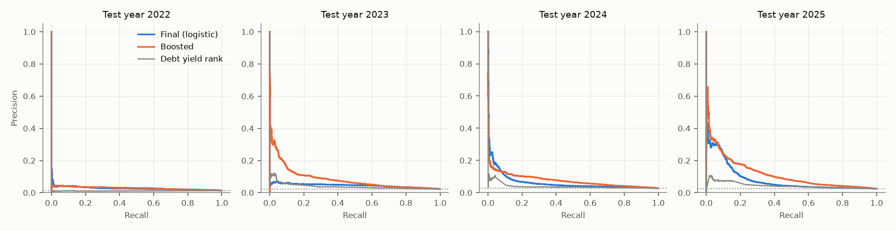
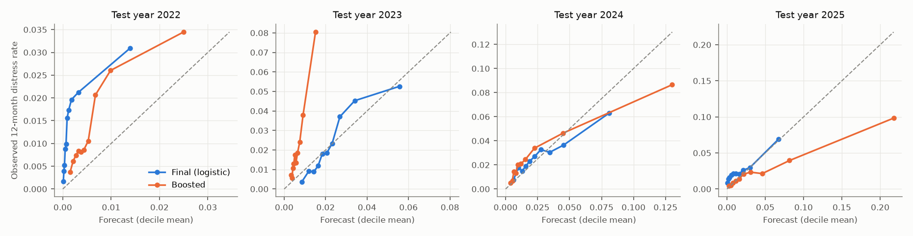
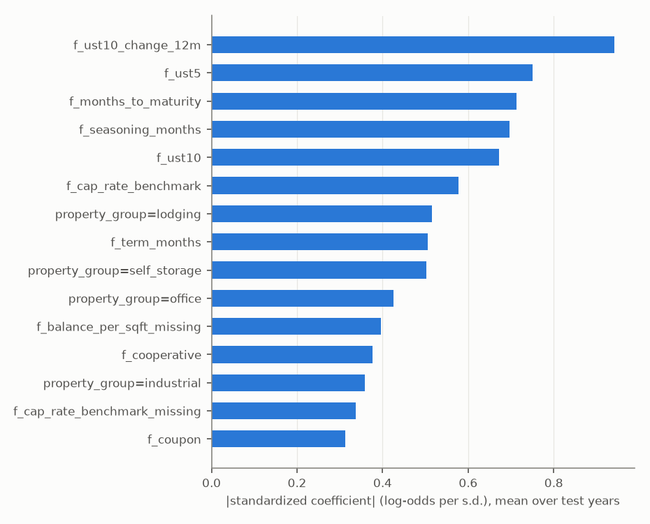
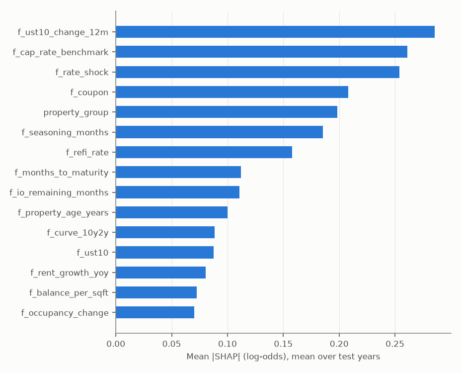
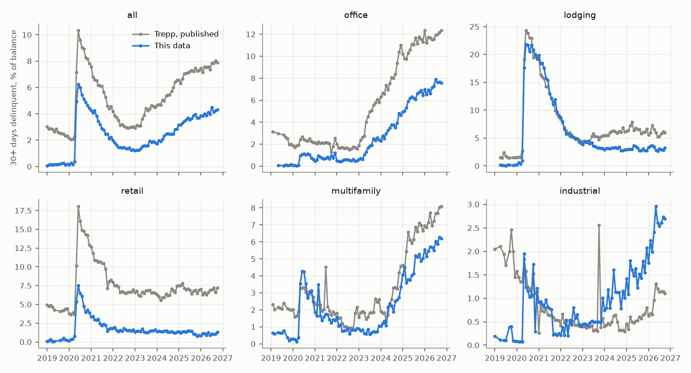

# Gate 3: models

Generated 2026-11-16 by `python -m mwall model` (stages in `src/mwall/model/run.py`). Design: `src/mwall/model/frame.py` (D051). Every test month below is out of time and out of loan. Final 12-month distress model: the sign-constrained logistic regression (D053, D054). Final failure-to-refinance model: the maturity-window model (D052).

Metrics: `pr_auc` is average precision (primary); `cal_slope` is the slope of the outcome on the forecast's log-odds (1 is ideal; below 1 means overconfident); `cal_intercept` is calibration in the large (0 is ideal; above 0 means the forecast is too low on average); `top10_capture` is the share of events in the 10% of loan-months ranked riskiest, and `_balance` the same share of event balance.

## Windows

| test year | training months | validation months | test months |
| --- | --- | --- | --- |
| 2022 | to 2019-11-18: 107,620 (3,482 events) | to 2020-11-17: 79,176 (4,795) | 2022: 107,948 (1,447) |
| 2023 | to 2020-11-17: 186,796 (8,277 events) | to 2021-11-17: 89,907 (1,197) | 2023: 111,160 (2,538) |
| 2024 | to 2021-11-17: 276,703 (9,474 events) | to 2022-11-17: 107,597 (1,397) | 2024: 116,579 (3,172) |
| 2025 | to 2022-11-18: 384,300 (10,871 events) | to 2023-11-18: 110,730 (2,430) | 2025: 103,200 (2,540) |

## Stage checks (SOP 11 and the Gate 3 checklist)

| test year | stage 1 (unconstrained logistic) beats every baseline | stage 2 (boosted) beats stage 1 on PR-AUC and Brier | final beats every baseline | final calibration slope (0.8 to 1.2) | credit-logic shocks passed |
| --- | --- | --- | --- | --- | --- |
| 2022 | yes | yes | yes | 0.46 out of range | logistic: 3 of 4 (fails: refinance rate up 100 bp); logistic, sign-constrained: 4 of 4; boosted: 2 of 4 (fails: NOI up 10%, refinance rate up 100 bp) |
| 2023 | yes | no | yes | 1.16 in range | logistic: 3 of 4 (fails: refinance rate up 100 bp); logistic, sign-constrained: 4 of 4; boosted: 3 of 4 (fails: refinance rate up 100 bp) |
| 2024 | yes | no | yes | 0.75 out of range | logistic: 3 of 4 (fails: refinance rate up 100 bp); logistic, sign-constrained: 4 of 4; boosted: 3 of 4 (fails: refinance rate up 100 bp) |
| 2025 | yes | no | yes | 0.51 out of range | logistic: 3 of 4 (fails: refinance rate up 100 bp); logistic, sign-constrained: 4 of 4; boosted: 4 of 4 |

## Results by test year

### 2022

| model | events | rate | mean_p | pr_auc | roc_auc | brier | log_loss | cal_slope | cal_intercept | top10_capture | top10_capture_balance |
| --- | --- | --- | --- | --- | --- | --- | --- | --- | --- | --- | --- |
| Logistic, sign-constrained (final) | 1447 | 0.0134 | 0.0023 | 0.0272 | 0.6883 | 0.0133 | 0.0858 | 0.4577 | 1.8621 | 0.2308 | 0.1651 |
| Logistic, unconstrained (first spec) | 1447 | 0.0134 | 0.0016 | 0.0238 | 0.6704 | 0.0133 | 0.0923 | 0.3726 | 2.1924 | 0.1990 | 0.1823 |
| Boosted trees (LightGBM) | 1447 | 0.0134 | 0.0065 | 0.0281 | 0.6880 | 0.0132 | 0.0717 | 0.7238 | 0.7491 | 0.2571 | 0.1864 |
| B0 base rate | 1447 | 0.0134 | 0.0606 | 0.0135 | 0.5009 | 0.0155 | 0.0992 | -1.5113 | -1.5570 | 0.0719 | 0.1755 |
| B1 debt yield < 7% | 1447 | 0.0134 | 0.0620 | 0.0146 | 0.4939 | 0.0157 | 0.1005 | 0.4584 | -1.5832 | 0.1818 | 0.3417 |
| B1 debt yield < 8% | 1447 | 0.0134 | 0.0616 | 0.0140 | 0.4975 | 0.0156 | 0.1003 | -0.2207 | -1.5767 | 0.1161 | 0.1943 |
| B1 debt yield < 9% | 1447 | 0.0134 | 0.0613 | 0.0120 | 0.4509 | 0.0156 | 0.1003 | -1.4899 | -1.5709 | 0.0981 | 0.1709 |
| B1 debt yield < 10% | 1447 | 0.0134 | 0.0614 | 0.0117 | 0.4413 | 0.0157 | 0.1005 | -1.4433 | -1.5720 | 0.0802 | 0.1308 |
| B1c debt yield, continuous | 1447 | 0.0134 | 0.0620 | 0.0111 | 0.4149 | 0.0159 | 0.1017 | -1.5214 | -1.5852 | 0.0836 | 0.1412 |
| B2 DSCR < 1.00 | 1447 | 0.0134 | 0.0616 | 0.0133 | 0.4675 | 0.0156 | 0.1002 | -0.2117 | -1.5750 | 0.1437 | 0.1770 |
| B2 DSCR < 1.10 | 1447 | 0.0134 | 0.0616 | 0.0137 | 0.4727 | 0.0156 | 0.1002 | 0.1706 | -1.5761 | 0.1596 | 0.1730 |
| B2 DSCR < 1.25 | 1447 | 0.0134 | 0.0617 | 0.0137 | 0.4753 | 0.0156 | 0.1002 | 0.4811 | -1.5787 | 0.1265 | 0.1447 |
| B3 refinance gap > 0 | 1447 | 0.0134 | 0.0568 | 0.0142 | 0.4998 | 0.0152 | 0.0965 | -0.0387 | -1.4911 | 0.1216 | 0.3274 |

### 2023

| model | events | rate | mean_p | pr_auc | roc_auc | brier | log_loss | cal_slope | cal_intercept | top10_capture | top10_capture_balance |
| --- | --- | --- | --- | --- | --- | --- | --- | --- | --- | --- | --- |
| Logistic, sign-constrained (final) | 2538 | 0.0228 | 0.0230 | 0.0451 | 0.6966 | 0.0221 | 0.1042 | 1.1558 | -0.0064 | 0.2305 | 0.2229 |
| Logistic, unconstrained (first spec) | 2538 | 0.0228 | 0.0223 | 0.0454 | 0.6965 | 0.0221 | 0.1041 | 1.1450 | 0.0266 | 0.2333 | 0.2361 |
| Boosted trees (LightGBM) | 2538 | 0.0228 | 0.0065 | 0.0833 | 0.7211 | 0.0224 | 0.1144 | 1.6249 | 1.2816 | 0.3522 | 0.3734 |
| B0 base rate | 2538 | 0.0228 | 0.0133 | 0.0252 | 0.5331 | 0.0224 | 0.1116 | 2.9205 | 0.5490 | 0.1462 | 0.1829 |
| B1 debt yield < 7% | 2538 | 0.0228 | 0.0124 | 0.0345 | 0.6053 | 0.0224 | 0.1107 | 1.2690 | 0.6235 | 0.2057 | 0.3107 |
| B1 debt yield < 8% | 2538 | 0.0228 | 0.0125 | 0.0334 | 0.6094 | 0.0224 | 0.1107 | 1.3467 | 0.6135 | 0.1962 | 0.3260 |
| B1 debt yield < 9% | 2538 | 0.0228 | 0.0126 | 0.0323 | 0.6114 | 0.0224 | 0.1106 | 1.4203 | 0.6073 | 0.1655 | 0.3043 |
| B1 debt yield < 10% | 2538 | 0.0228 | 0.0127 | 0.0290 | 0.5833 | 0.0224 | 0.1111 | 1.2921 | 0.5993 | 0.1458 | 0.2860 |
| B1c debt yield, continuous | 2538 | 0.0228 | 0.0122 | 0.0379 | 0.6101 | 0.0224 | 0.1111 | 1.0398 | 0.6391 | 0.1950 | 0.2860 |
| B2 DSCR < 1.00 | 2538 | 0.0228 | 0.0133 | 0.0276 | 0.5707 | 0.0224 | 0.1118 | 0.4960 | 0.5540 | 0.1214 | 0.1553 |
| B2 DSCR < 1.10 | 2538 | 0.0228 | 0.0131 | 0.0283 | 0.5791 | 0.0224 | 0.1117 | 0.5480 | 0.5658 | 0.1348 | 0.1911 |
| B2 DSCR < 1.25 | 2538 | 0.0228 | 0.0129 | 0.0296 | 0.5903 | 0.0224 | 0.1113 | 0.7180 | 0.5844 | 0.1261 | 0.1791 |
| B3 refinance gap > 0 | 2538 | 0.0228 | 0.0133 | 0.0252 | 0.5370 | 0.0224 | 0.1116 | 0.6102 | 0.5499 | 0.1186 | 0.0507 |

### 2024

| model | events | rate | mean_p | pr_auc | roc_auc | brier | log_loss | cal_slope | cal_intercept | top10_capture | top10_capture_balance |
| --- | --- | --- | --- | --- | --- | --- | --- | --- | --- | --- | --- |
| Logistic, sign-constrained (final) | 3172 | 0.0272 | 0.0275 | 0.0626 | 0.6458 | 0.0262 | 0.1211 | 0.7462 | -0.0103 | 0.2317 | 0.2848 |
| Logistic, unconstrained (first spec) | 3172 | 0.0272 | 0.0239 | 0.0631 | 0.6482 | 0.0261 | 0.1211 | 0.7638 | 0.1347 | 0.2390 | 0.3017 |
| Boosted trees (LightGBM) | 3172 | 0.0272 | 0.0258 | 0.0756 | 0.7202 | 0.0263 | 0.1189 | 0.6528 | 0.0585 | 0.3181 | 0.4446 |
| B0 base rate | 3172 | 0.0272 | 0.0130 | 0.0271 | 0.4952 | 0.0267 | 0.1309 | 0.0210 | 0.7542 | 0.0851 | 0.0836 |
| B1 debt yield < 7% | 3172 | 0.0272 | 0.0125 | 0.0412 | 0.5914 | 0.0266 | 0.1298 | 1.1257 | 0.7986 | 0.2137 | 0.3253 |
| B1 debt yield < 8% | 3172 | 0.0272 | 0.0126 | 0.0380 | 0.5980 | 0.0266 | 0.1297 | 1.3071 | 0.7880 | 0.1639 | 0.2090 |
| B1 debt yield < 9% | 3172 | 0.0272 | 0.0127 | 0.0325 | 0.5752 | 0.0266 | 0.1302 | 1.1733 | 0.7791 | 0.1148 | 0.0436 |
| B1 debt yield < 10% | 3172 | 0.0272 | 0.0127 | 0.0317 | 0.5663 | 0.0267 | 0.1305 | 0.9947 | 0.7759 | 0.1148 | 0.0436 |
| B1c debt yield, continuous | 3172 | 0.0272 | 0.0126 | 0.0365 | 0.5734 | 0.0266 | 0.1305 | 0.8940 | 0.7828 | 0.1368 | 0.0780 |
| B2 DSCR < 1.00 | 3172 | 0.0272 | 0.0129 | 0.0318 | 0.5503 | 0.0266 | 0.1306 | 0.6736 | 0.7638 | 0.1337 | 0.0581 |
| B2 DSCR < 1.10 | 3172 | 0.0272 | 0.0128 | 0.0320 | 0.5567 | 0.0266 | 0.1305 | 0.7240 | 0.7674 | 0.1242 | 0.1178 |
| B2 DSCR < 1.25 | 3172 | 0.0272 | 0.0128 | 0.0340 | 0.5691 | 0.0266 | 0.1300 | 0.9103 | 0.7714 | 0.1441 | 0.0730 |
| B3 refinance gap > 0 | 3172 | 0.0272 | 0.0127 | 0.0298 | 0.5338 | 0.0267 | 0.1311 | 0.6497 | 0.7752 | 0.1189 | 0.2169 |

### 2025

| model | events | rate | mean_p | pr_auc | roc_auc | brier | log_loss | cal_slope | cal_intercept | top10_capture | top10_capture_balance |
| --- | --- | --- | --- | --- | --- | --- | --- | --- | --- | --- | --- |
| Logistic, sign-constrained (final) | 2540 | 0.0246 | 0.0166 | 0.0810 | 0.6542 | 0.0235 | 0.1160 | 0.5122 | 0.4200 | 0.2811 | 0.3717 |
| Logistic, unconstrained (first spec) | 2540 | 0.0246 | 0.0216 | 0.0964 | 0.7080 | 0.0232 | 0.1076 | 0.8211 | 0.1393 | 0.3409 | 0.5067 |
| Boosted trees (LightGBM) | 2540 | 0.0246 | 0.0440 | 0.1139 | 0.7561 | 0.0248 | 0.1105 | 0.7290 | -0.6656 | 0.3992 | 0.5404 |
| B0 base rate | 2540 | 0.0246 | 0.0220 | 0.0250 | 0.5017 | 0.0240 | 0.1157 | -1.0949 | 0.1172 | 0.1098 | 0.1087 |
| B1 debt yield < 7% | 2540 | 0.0246 | 0.0223 | 0.0387 | 0.6003 | 0.0239 | 0.1133 | 1.0850 | 0.1002 | 0.2252 | 0.2668 |
| B1 debt yield < 8% | 2540 | 0.0246 | 0.0222 | 0.0382 | 0.6109 | 0.0239 | 0.1133 | 1.1083 | 0.1075 | 0.2260 | 0.3252 |
| B1 debt yield < 9% | 2540 | 0.0246 | 0.0221 | 0.0369 | 0.6218 | 0.0239 | 0.1133 | 1.1010 | 0.1126 | 0.1850 | 0.2142 |
| B1 debt yield < 10% | 2540 | 0.0246 | 0.0221 | 0.0323 | 0.6067 | 0.0239 | 0.1134 | 1.2932 | 0.1126 | 0.1413 | 0.1066 |
| B1c debt yield, continuous | 2540 | 0.0246 | 0.0220 | 0.0433 | 0.6428 | 0.0239 | 0.1126 | 1.2155 | 0.1138 | 0.2177 | 0.2580 |
| B2 DSCR < 1.00 | 2540 | 0.0246 | 0.0231 | 0.0299 | 0.5587 | 0.0240 | 0.1149 | 0.7352 | 0.0654 | 0.1378 | 0.0661 |
| B2 DSCR < 1.10 | 2540 | 0.0246 | 0.0231 | 0.0305 | 0.5707 | 0.0240 | 0.1146 | 0.8206 | 0.0661 | 0.1378 | 0.0661 |
| B2 DSCR < 1.25 | 2540 | 0.0246 | 0.0231 | 0.0318 | 0.5920 | 0.0239 | 0.1138 | 0.9891 | 0.0640 | 0.1378 | 0.0661 |
| B3 refinance gap > 0 | 2540 | 0.0246 | 0.0219 | 0.0321 | 0.5898 | 0.0240 | 0.1145 | 1.4879 | 0.1204 | 0.1539 | 0.2430 |

### All four test years pooled

| model | events | rate | mean_p | pr_auc | roc_auc | brier | log_loss | cal_slope | cal_intercept | top10_capture | top10_capture_balance |
| --- | --- | --- | --- | --- | --- | --- | --- | --- | --- | --- | --- |
| Logistic, sign-constrained (final) | 9697 | 0.0221 | 0.0176 | 0.0569 | 0.6624 | 0.0214 | 0.1070 | 0.4279 | 0.2397 | 0.2518 | 0.2726 |
| Logistic, unconstrained (first spec) | 9697 | 0.0221 | 0.0175 | 0.0621 | 0.6743 | 0.0213 | 0.1066 | 0.4288 | 0.2462 | 0.2725 | 0.3073 |
| Boosted trees (LightGBM) | 9697 | 0.0221 | 0.0204 | 0.0692 | 0.7072 | 0.0217 | 0.1042 | 0.5618 | 0.0891 | 0.2993 | 0.3382 |
| B0 base rate | 9697 | 0.0221 | 0.0269 | 0.0190 | 0.4510 | 0.0222 | 0.1147 | -0.3818 | -0.2036 | 0.0639 | 0.1002 |
| B1 debt yield < 7% | 9697 | 0.0221 | 0.0269 | 0.0209 | 0.5004 | 0.0222 | 0.1139 | -0.0672 | -0.2066 | 0.0618 | 0.1392 |
| B1 debt yield < 8% | 9697 | 0.0221 | 0.0269 | 0.0209 | 0.5052 | 0.0222 | 0.1138 | -0.0832 | -0.2041 | 0.0633 | 0.1295 |
| B1 debt yield < 9% | 9697 | 0.0221 | 0.0268 | 0.0207 | 0.5060 | 0.0222 | 0.1139 | -0.1035 | -0.2019 | 0.0543 | 0.1197 |
| B1 debt yield < 10% | 9697 | 0.0221 | 0.0269 | 0.0203 | 0.4961 | 0.0222 | 0.1142 | -0.1436 | -0.2036 | 0.0466 | 0.0792 |
| B1c debt yield, continuous | 9697 | 0.0221 | 0.0269 | 0.0205 | 0.5023 | 0.0223 | 0.1143 | -0.0597 | -0.2043 | 0.0470 | 0.0866 |
| B2 DSCR < 1.00 | 9697 | 0.0221 | 0.0274 | 0.0198 | 0.4766 | 0.0222 | 0.1147 | -0.1765 | -0.2222 | 0.0594 | 0.1229 |
| B2 DSCR < 1.10 | 9697 | 0.0221 | 0.0273 | 0.0201 | 0.4844 | 0.0222 | 0.1145 | -0.1414 | -0.2208 | 0.0603 | 0.1238 |
| B2 DSCR < 1.25 | 9697 | 0.0221 | 0.0273 | 0.0205 | 0.4953 | 0.0222 | 0.1141 | -0.0912 | -0.2196 | 0.0622 | 0.1186 |
| B3 refinance gap > 0 | 9697 | 0.0221 | 0.0259 | 0.0195 | 0.4647 | 0.0221 | 0.1137 | -0.2512 | -0.1639 | 0.0577 | 0.1307 |

## Credit logic (consistent shocks, D054)

Each shock moves every input it touches together (`src/mwall/model/logic.py`); the table gives the mean change in log-odds over the test months and the share of months moving the expected way.

| origin | shock | model | expected | mean_log_odds_change | share_expected_way | pass |
| --- | --- | --- | --- | --- | --- | --- |
| 2022 | NOI up 10% | logistic | down | -0.095 | 0.705 | True |
| 2022 | NOI up 10% | logistic, sign-constrained | down | -0.086 | 0.722 | True |
| 2022 | NOI up 10% | boosted | down | 0.049 | 0.290 | False |
| 2022 | balance up 10% | logistic | up | 0.080 | 0.764 | True |
| 2022 | balance up 10% | logistic, sign-constrained | up | 0.085 | 0.966 | True |
| 2022 | balance up 10% | boosted | up | 0.231 | 0.774 | True |
| 2022 | occupancy up 5 points | logistic | down | -0.034 | 0.525 | True |
| 2022 | occupancy up 5 points | logistic, sign-constrained | down | -0.042 | 0.525 | True |
| 2022 | occupancy up 5 points | boosted | down | -0.052 | 0.409 | True |
| 2022 | refinance rate up 100 bp | logistic | up | -0.096 | 0.188 | False |
| 2022 | refinance rate up 100 bp | logistic, sign-constrained | up | 0.005 | 0.183 | True |
| 2022 | refinance rate up 100 bp | boosted | up | -0.392 | 0.101 | False |
| 2023 | NOI up 10% | logistic | down | -0.054 | 0.719 | True |
| 2023 | NOI up 10% | logistic, sign-constrained | down | -0.052 | 0.731 | True |
| 2023 | NOI up 10% | boosted | down | -0.009 | 0.402 | True |
| 2023 | balance up 10% | logistic | up | 0.092 | 0.961 | True |
| 2023 | balance up 10% | logistic, sign-constrained | up | 0.095 | 0.964 | True |
| 2023 | balance up 10% | boosted | up | 0.153 | 0.781 | True |
| 2023 | occupancy up 5 points | logistic | down | -0.018 | 0.473 | True |
| 2023 | occupancy up 5 points | logistic, sign-constrained | down | -0.019 | 0.473 | True |
| 2023 | occupancy up 5 points | boosted | down | -0.031 | 0.338 | True |
| 2023 | refinance rate up 100 bp | logistic | up | -0.003 | 0.479 | False |
| 2023 | refinance rate up 100 bp | logistic, sign-constrained | up | 0.014 | 0.719 | True |
| 2023 | refinance rate up 100 bp | boosted | up | -0.024 | 0.132 | False |
| 2024 | NOI up 10% | logistic | down | -0.033 | 0.715 | True |
| 2024 | NOI up 10% | logistic, sign-constrained | down | -0.030 | 0.735 | True |
| 2024 | NOI up 10% | boosted | down | -0.022 | 0.455 | True |
| 2024 | balance up 10% | logistic | up | 0.060 | 0.953 | True |
| 2024 | balance up 10% | logistic, sign-constrained | up | 0.066 | 0.966 | True |
| 2024 | balance up 10% | boosted | up | 0.061 | 0.776 | True |
| 2024 | occupancy up 5 points | logistic | down | -0.014 | 0.460 | True |
| 2024 | occupancy up 5 points | logistic, sign-constrained | down | -0.016 | 0.460 | True |
| 2024 | occupancy up 5 points | boosted | down | -0.014 | 0.126 | True |
| 2024 | refinance rate up 100 bp | logistic | up | -0.023 | 0.545 | False |
| 2024 | refinance rate up 100 bp | logistic, sign-constrained | up | 0.009 | 0.730 | True |
| 2024 | refinance rate up 100 bp | boosted | up | -0.033 | 0.061 | False |
| 2025 | NOI up 10% | logistic | down | -0.032 | 0.606 | True |
| 2025 | NOI up 10% | logistic, sign-constrained | down | -0.029 | 0.678 | True |
| 2025 | NOI up 10% | boosted | down | -0.025 | 0.428 | True |
| 2025 | balance up 10% | logistic | up | 0.026 | 0.703 | True |
| 2025 | balance up 10% | logistic, sign-constrained | up | 0.037 | 0.961 | True |
| 2025 | balance up 10% | boosted | up | 0.071 | 0.755 | True |
| 2025 | occupancy up 5 points | logistic | down | -0.014 | 0.429 | True |
| 2025 | occupancy up 5 points | logistic, sign-constrained | down | -0.015 | 0.429 | True |
| 2025 | occupancy up 5 points | boosted | down | -0.017 | 0.267 | True |
| 2025 | refinance rate up 100 bp | logistic | up | -0.065 | 0.287 | False |
| 2025 | refinance rate up 100 bp | logistic, sign-constrained | up | 0.007 | 0.673 | True |
| 2025 | refinance rate up 100 bp | boosted | up | 0.055 | 0.381 | True |

## Cuts, all test years pooled

Segments with fewer than 30 events are marked; their metrics are too noisy to read.

### By property type

| property_group | model | n | events | rate | mean_p | pr_auc | roc_auc | brier | cal_slope | note |
| --- | --- | --- | --- | --- | --- | --- | --- | --- | --- | --- |
| office | Logistic, sign-constrained (final) | 74285 | 3185 | 0.0429 | 0.0189 | 0.0787 | 0.6320 | 0.0412 | 0.2762 |  |
| office | Boosted trees (LightGBM) | 74285 | 3185 | 0.0429 | 0.0527 | 0.0886 | 0.6266 | 0.0440 | 0.2497 |  |
| office | B1c debt yield, continuous | 74285 | 3185 | 0.0429 | 0.0274 | 0.0398 | 0.4979 | 0.0420 | -0.0926 |  |
| retail | Logistic, sign-constrained (final) | 116363 | 1608 | 0.0138 | 0.0165 | 0.0286 | 0.6195 | 0.0136 | 0.3280 |  |
| retail | Boosted trees (LightGBM) | 116363 | 1608 | 0.0138 | 0.0138 | 0.0379 | 0.6495 | 0.0137 | 0.5900 |  |
| retail | B1c debt yield, continuous | 116363 | 1608 | 0.0138 | 0.0263 | 0.0131 | 0.5052 | 0.0143 | -0.1055 |  |
| lodging | Logistic, sign-constrained (final) | 46705 | 1045 | 0.0224 | 0.0375 | 0.0455 | 0.5898 | 0.0225 | 0.2849 |  |
| lodging | Boosted trees (LightGBM) | 46705 | 1045 | 0.0224 | 0.0236 | 0.0565 | 0.6623 | 0.0219 | 0.5762 |  |
| lodging | B1c debt yield, continuous | 46705 | 1045 | 0.0224 | 0.0271 | 0.0260 | 0.5983 | 0.0227 | 0.2491 |  |
| industrial | Logistic, sign-constrained (final) | 32338 | 661 | 0.0204 | 0.0096 | 0.0732 | 0.6719 | 0.0198 | 0.4410 |  |
| industrial | Boosted trees (LightGBM) | 32338 | 661 | 0.0204 | 0.0106 | 0.0808 | 0.7828 | 0.0198 | 0.8623 |  |
| industrial | B1c debt yield, continuous | 32338 | 661 | 0.0204 | 0.0265 | 0.0200 | 0.5180 | 0.0207 | -0.0216 |  |
| multifamily | Logistic, sign-constrained (final) | 95057 | 2084 | 0.0219 | 0.0116 | 0.1143 | 0.7614 | 0.0209 | 0.9118 |  |
| multifamily | Boosted trees (LightGBM) | 95057 | 2084 | 0.0219 | 0.0110 | 0.1227 | 0.7721 | 0.0207 | 1.0238 |  |
| multifamily | B1c debt yield, continuous | 95057 | 2084 | 0.0219 | 0.0275 | 0.0171 | 0.4171 | 0.0222 | -0.4467 |  |
| self_storage | Logistic, sign-constrained (final) | 39840 | 161 | 0.0040 | 0.0103 | 0.0061 | 0.6562 | 0.0042 | 0.5282 |  |
| self_storage | Boosted trees (LightGBM) | 39840 | 161 | 0.0040 | 0.0059 | 0.0318 | 0.7695 | 0.0040 | 1.2292 |  |
| self_storage | B1c debt yield, continuous | 39840 | 161 | 0.0040 | 0.0265 | 0.0036 | 0.4751 | 0.0052 | -0.1482 |  |
| mixed_use | Logistic, sign-constrained (final) | 29338 | 786 | 0.0268 | 0.0251 | 0.1373 | 0.6750 | 0.0249 | 0.5146 |  |
| mixed_use | Boosted trees (LightGBM) | 29338 | 786 | 0.0268 | 0.0218 | 0.1243 | 0.6897 | 0.0251 | 0.6260 |  |
| mixed_use | B1c debt yield, continuous | 29338 | 786 | 0.0268 | 0.0264 | 0.0250 | 0.5072 | 0.0266 | -0.0372 |  |
| other | Logistic, sign-constrained (final) | 4564 | 157 | 0.0344 | 0.0177 | 0.3043 | 0.7152 | 0.0312 | 0.7634 |  |
| other | Boosted trees (LightGBM) | 4564 | 157 | 0.0344 | 0.0132 | 0.2183 | 0.7954 | 0.0315 | 1.0900 |  |
| other | B1c debt yield, continuous | 4564 | 157 | 0.0344 | 0.0265 | 0.0372 | 0.5308 | 0.0339 | -0.0733 |  |

### By vintage

| vintage_band | model | n | events | rate | mean_p | pr_auc | roc_auc | brier | cal_slope | note |
| --- | --- | --- | --- | --- | --- | --- | --- | --- | --- | --- |
| 2016 or earlier | Logistic, sign-constrained (final) | 8897 | 387 | 0.0435 | 0.0165 | 0.0529 | 0.5934 | 0.0425 | 0.2874 |  |
| 2016 or earlier | Boosted trees (LightGBM) | 8897 | 387 | 0.0435 | 0.0308 | 0.0682 | 0.5926 | 0.0440 | 0.2023 |  |
| 2016 or earlier | B1c debt yield, continuous | 8897 | 387 | 0.0435 | 0.0282 | 0.0337 | 0.4140 | 0.0434 | -0.3619 |  |
| 2017-18 | Logistic, sign-constrained (final) | 147172 | 3751 | 0.0255 | 0.0177 | 0.0467 | 0.6092 | 0.0248 | 0.2575 |  |
| 2017-18 | Boosted trees (LightGBM) | 147172 | 3751 | 0.0255 | 0.0248 | 0.0613 | 0.6612 | 0.0257 | 0.4431 |  |
| 2017-18 | B1c debt yield, continuous | 147172 | 3751 | 0.0255 | 0.0286 | 0.0257 | 0.5369 | 0.0255 | 0.0839 |  |
| 2019-20 | Logistic, sign-constrained (final) | 136825 | 3046 | 0.0223 | 0.0180 | 0.0713 | 0.7145 | 0.0213 | 0.6290 |  |
| 2019-20 | Boosted trees (LightGBM) | 136825 | 3046 | 0.0223 | 0.0162 | 0.0889 | 0.7396 | 0.0213 | 0.6576 |  |
| 2019-20 | B1c debt yield, continuous | 136825 | 3046 | 0.0223 | 0.0280 | 0.0191 | 0.4713 | 0.0226 | -0.2023 |  |
| 2021-22 | Logistic, sign-constrained (final) | 108478 | 1479 | 0.0136 | 0.0138 | 0.0711 | 0.7134 | 0.0131 | 0.6190 |  |
| 2021-22 | Boosted trees (LightGBM) | 108478 | 1479 | 0.0136 | 0.0132 | 0.0792 | 0.7410 | 0.0131 | 0.7324 |  |
| 2021-22 | B1c debt yield, continuous | 108478 | 1479 | 0.0136 | 0.0252 | 0.0121 | 0.4867 | 0.0141 | -0.1947 |  |
| 2023+ | Logistic, sign-constrained (final) | 37515 | 1034 | 0.0276 | 0.0268 | 0.0610 | 0.6058 | 0.0266 | 0.4922 |  |
| 2023+ | Boosted trees (LightGBM) | 37515 | 1034 | 0.0276 | 0.0373 | 0.0744 | 0.6681 | 0.0271 | 0.6475 |  |
| 2023+ | B1c debt yield, continuous | 37515 | 1034 | 0.0276 | 0.0205 | 0.0314 | 0.5338 | 0.0269 | 0.3188 |  |

### By structure

| structure | model | n | events | rate | mean_p | pr_auc | roc_auc | brier | cal_slope | note |
| --- | --- | --- | --- | --- | --- | --- | --- | --- | --- | --- |
| pool / portfolio | Logistic, sign-constrained (final) | 60516 | 2071 | 0.0342 | 0.0188 | 0.0722 | 0.6439 | 0.0328 | 0.3665 |  |
| pool / portfolio | Boosted trees (LightGBM) | 60516 | 2071 | 0.0342 | 0.0215 | 0.0954 | 0.6998 | 0.0327 | 0.5579 |  |
| pool / portfolio | B1c debt yield, continuous | 60516 | 2071 | 0.0342 | 0.0269 | 0.0330 | 0.5212 | 0.0337 | 0.0018 |  |
| single asset | Logistic, sign-constrained (final) | 378371 | 7626 | 0.0202 | 0.0174 | 0.0544 | 0.6660 | 0.0195 | 0.4404 |  |
| single asset | Boosted trees (LightGBM) | 378371 | 7626 | 0.0202 | 0.0202 | 0.0649 | 0.7070 | 0.0200 | 0.5616 |  |
| single asset | B1c debt yield, continuous | 378371 | 7626 | 0.0202 | 0.0269 | 0.0185 | 0.4952 | 0.0204 | -0.0801 |  |

### By NOI

| noi_status | model | n | events | rate | mean_p | pr_auc | roc_auc | brier | cal_slope | note |
| --- | --- | --- | --- | --- | --- | --- | --- | --- | --- | --- |
| current NOI | Logistic, sign-constrained (final) | 318276 | 6481 | 0.0204 | 0.0177 | 0.0497 | 0.6578 | 0.0198 | 0.4173 |  |
| current NOI | Boosted trees (LightGBM) | 318276 | 6481 | 0.0204 | 0.0196 | 0.0688 | 0.7124 | 0.0201 | 0.5746 |  |
| current NOI | B1c debt yield, continuous | 318276 | 6481 | 0.0204 | 0.0266 | 0.0191 | 0.5075 | 0.0207 | -0.0497 |  |
| no current NOI | Logistic, sign-constrained (final) | 120611 | 3216 | 0.0267 | 0.0172 | 0.0766 | 0.6739 | 0.0255 | 0.4519 |  |
| no current NOI | Boosted trees (LightGBM) | 120611 | 3216 | 0.0267 | 0.0225 | 0.0714 | 0.6896 | 0.0261 | 0.5249 |  |
| no current NOI | B1c debt yield, continuous | 120611 | 3216 | 0.0267 | 0.0277 | 0.0235 | 0.4575 | 0.0263 | -0.3941 |  |

## Importance and its stability (SOP 11 stage 4)

Final model: inputs are standardized, so a coefficient's size is the change in log-odds for a one standard deviation move, and the per-loan drivers on the site are exact SHAP values of this linear model (coefficient times the input's distance from its training mean).

Rank of the 15 largest in each test year:

| feature | 2022 | 2023 | 2024 | 2025 |
| --- | --- | --- | --- | --- |
| f_ust10_change_12m | 1 | 1 | 1 | 8 |
| f_ust5 | 5 | 43 | 18 | 2 |
| f_months_to_maturity | 37 | 84 | 76 | 1 |
| f_seasoning_months | 15 | 36 | 16 | 3 |
| f_ust10 | 7 | 63 | 35 | 4 |
| f_cap_rate_benchmark | 2 | 2 | 2 | 35 |
| property_group=lodging | 3 | 3 | 3 | 26 |
| f_term_months | 93 | 58 | 42 | 5 |
| property_group=self_storage | 10 | 6 | 4 | 9 |
| property_group=office | 6 | 8 | 10 | 16 |
| f_balance_per_sqft_missing | 4 | 4 | 5 | 27 |
| f_cooperative | 11 | 10 | 8 | 18 |
| property_group=industrial | 44 | 34 | 26 | 6 |
| f_cap_rate_benchmark_missing | 21 | 31 | 31 | 7 |
| f_coupon | 8 | 9 | 7 | 38 |

Rank correlation of all inputs between consecutive test years: 2022 vs 2023: 0.81; 2023 vs 2024: 0.88; 2024 vs 2025: 0.54.

Boosted model, mean absolute SHAP:

| feature | 2022 | 2023 | 2024 | 2025 |
| --- | --- | --- | --- | --- |
| f_ust10_change_12m | 2 | 2 | 2 | 6 |
| f_cap_rate_benchmark | 7 | 3 | 1 | 2 |
| f_rate_shock | 1 | 1 | 3 | 17 |
| f_coupon | 6 | 5 | 5 | 1 |
| property_group | 5 | 4 | 4 | 5 |
| f_seasoning_months | 4 | 7 | 7 | 3 |
| f_refi_rate | 3 | 6 | 19 | 7 |
| f_months_to_maturity | 20 | 15 | 10 | 4 |
| f_io_remaining_months | 8 | 8 | 9 | 9 |
| f_property_age_years | 10 | 10 | 12 | 10 |
| f_curve_10y2y | 40 | 14 | 6 | 11 |
| f_ust10 | 9 | 11 | 8 | 38 |
| f_rent_growth_yoy | 12 | 9 | 13 | 20 |
| f_balance_per_sqft | 13 | 13 | 14 | 13 |
| f_occupancy_change | 11 | 16 | 15 | 18 |

Rank correlation between consecutive test years: 2022 vs 2023: 0.93; 2023 vs 2024: 0.95; 2024 vs 2025: 0.94.

## Robustness suite (SOP 11)

### signed ablation no market (Logistic, sign-constrained (final))

| origin | PR-AUC | PR-AUC, full model | Brier | Brier, full model |
| --- | --- | --- | --- | --- |
| 2022 | 0.0282 | 0.0272 | 0.0271 | 0.0133 |
| 2023 | 0.0400 | 0.0451 | 0.0223 | 0.0221 |
| 2024 | 0.0534 | 0.0626 | 0.0265 | 0.0262 |
| 2025 | 0.0429 | 0.0810 | 0.0241 | 0.0235 |

### signed ablation no noi (Logistic, sign-constrained (final))

| origin | PR-AUC | PR-AUC, full model | Brier | Brier, full model |
| --- | --- | --- | --- | --- |
| 2022 | 0.0252 | 0.0272 | 0.0133 | 0.0133 |
| 2023 | 0.0428 | 0.0451 | 0.0221 | 0.0221 |
| 2024 | 0.0609 | 0.0626 | 0.0263 | 0.0262 |
| 2025 | 0.0784 | 0.0810 | 0.0235 | 0.0235 |

### signed ablation no servicing (Logistic, sign-constrained (final))

| origin | PR-AUC | PR-AUC, full model | Brier | Brier, full model |
| --- | --- | --- | --- | --- |
| 2022 | 0.0267 | 0.0272 | 0.0133 | 0.0133 |
| 2023 | 0.0395 | 0.0451 | 0.0222 | 0.0221 |
| 2024 | 0.0417 | 0.0626 | 0.0265 | 0.0262 |
| 2025 | 0.0570 | 0.0810 | 0.0238 | 0.0235 |

### signed family holdout (Logistic, sign-constrained (final))

| origin | PR-AUC | PR-AUC, full model | Brier | Brier, full model |
| --- | --- | --- | --- | --- |
| 2022 | 0.0225 | 0.0272 | 0.0133 | 0.0133 |
| 2023 | 0.0429 | 0.0451 | 0.0221 | 0.0221 |
| 2024 | 0.0551 | 0.0626 | 0.0263 | 0.0262 |
| 2025 | 0.0891 | 0.0810 | 0.0234 | 0.0235 |

| origin | model | n | events | pr_auc | brier | cal_slope |
| --- | --- | --- | --- | --- | --- | --- |
| 2022 | Logistic, sign-constrained (final) | 107948 | 1447 | 0.0225 | 0.0133 | 0.3756 |
| 2022 | B1c debt yield, continuous | 107948 | 1447 | 0.0101 | 0.0161 | -2.2009 |
| 2023 | Logistic, sign-constrained (final) | 111160 | 2538 | 0.0429 | 0.0221 | 1.1542 |
| 2023 | B1c debt yield, continuous | 111160 | 2538 | 0.0311 | 0.0224 | 0.6355 |
| 2024 | Logistic, sign-constrained (final) | 116579 | 3172 | 0.0551 | 0.0263 | 0.6510 |
| 2024 | B1c debt yield, continuous | 116579 | 3172 | 0.0306 | 0.0267 | 0.2341 |
| 2025 | Logistic, sign-constrained (final) | 103200 | 2540 | 0.0891 | 0.0234 | 1.0895 |
| 2025 | B1c debt yield, continuous | 103200 | 2540 | 0.0368 | 0.0239 | 0.8804 |

### Refinance rate moved 100 bp

Same fitted models; the rate-dependent features are recomputed (`model/scenario.py`).

| model | origin | scenario | rank_corr | top_decile_kept | mean_p_change_pct | share_up |
| --- | --- | --- | --- | --- | --- | --- |
| Logistic, sign-constrained (final) | 2022 | rate down 100 | 1.000 | 1.000 | -0.002 | 0.102 |
| Logistic, sign-constrained (final) | 2022 | rate up 100 | 1.000 | 0.999 | 0.160 | 0.185 |
| Logistic, sign-constrained (final) | 2023 | rate down 100 | 1.000 | 0.998 | -0.199 | 0.000 |
| Logistic, sign-constrained (final) | 2023 | rate up 100 | 1.000 | 0.995 | 0.416 | 0.720 |
| Logistic, sign-constrained (final) | 2024 | rate down 100 | 1.000 | 0.998 | -0.302 | 0.000 |
| Logistic, sign-constrained (final) | 2024 | rate up 100 | 1.000 | 0.997 | 0.290 | 0.731 |
| Logistic, sign-constrained (final) | 2025 | rate down 100 | 1.000 | 0.996 | -0.413 | 0.000 |
| Logistic, sign-constrained (final) | 2025 | rate up 100 | 1.000 | 0.996 | 0.374 | 0.552 |
| Boosted trees (LightGBM) | 2022 | rate down 100 | 0.828 | 0.629 | 74.068 | 0.858 |
| Boosted trees (LightGBM) | 2022 | rate up 100 | 0.919 | 0.653 | -28.576 | 0.090 |
| Boosted trees (LightGBM) | 2023 | rate down 100 | 0.963 | 0.734 | 14.918 | 0.499 |
| Boosted trees (LightGBM) | 2023 | rate up 100 | 0.996 | 0.886 | -2.439 | 0.129 |
| Boosted trees (LightGBM) | 2024 | rate down 100 | 0.993 | 0.945 | 6.923 | 0.397 |
| Boosted trees (LightGBM) | 2024 | rate up 100 | 0.993 | 0.970 | -3.880 | 0.147 |
| Boosted trees (LightGBM) | 2025 | rate down 100 | 0.991 | 0.947 | -17.739 | 0.141 |
| Boosted trees (LightGBM) | 2025 | rate up 100 | 0.993 | 0.977 | 0.621 | 0.463 |

## Maturity outcome (tier 1, D052)

### grace 90 days, 12 months before maturity

| test_year | sample | model | n | events | pr_auc | roc_auc | brier | cal_slope |
| --- | --- | --- | --- | --- | --- | --- | --- | --- |
| all | all loans | A maturity model | 229 | 109 | 0.600 | 0.560 | 0.290 | 0.271 |
| all | loans with a distress score | A maturity model | 217 | 99 | 0.515 | 0.521 | 0.303 | 0.126 |
| all | loans with a distress score | C ensemble | 217 | 99 | 0.469 | 0.476 | 0.298 | -0.033 |
| all | loans with a distress score | B distress, recalibrated | 217 | 99 | 0.412 | 0.433 | 0.304 | -0.380 |
| all | all loans | B0 base rate | 229 | 109 | 0.441 | 0.433 | 0.297 | -1.084 |
| all | loans with a distress score | B0 base rate | 217 | 99 | 0.416 | 0.414 | 0.291 | -1.450 |
| all | all loans | B1 debt yield < 8% | 229 | 109 | 0.508 | 0.485 | 0.298 | -0.088 |
| all | loans with a distress score | B1 debt yield < 8% | 217 | 99 | 0.472 | 0.474 | 0.292 | -0.166 |
| all | all loans | B2 DSCR < 1.25 | 229 | 109 | 0.446 | 0.439 | 0.303 | -0.552 |
| all | loans with a distress score | B2 DSCR < 1.25 | 217 | 99 | 0.417 | 0.426 | 0.297 | -0.653 |
| all | all loans | B3 refinance gap > 0 | 229 | 109 | 0.424 | 0.393 | 0.301 | -1.052 |
| all | loans with a distress score | B3 refinance gap > 0 | 217 | 99 | 0.394 | 0.375 | 0.297 | -1.269 |
| 2024 | all loans | A maturity model | 124 | 65 | 0.614 | 0.558 | 0.343 | 0.264 |
| 2024 | loans with a distress score | A maturity model | 118 | 61 | 0.562 | 0.541 | 0.354 | 0.173 |
| 2024 | loans with a distress score | C ensemble | 118 | 61 | 0.551 | 0.538 | 0.347 | 0.375 |
| 2024 | loans with a distress score | B distress, recalibrated | 118 | 61 | 0.543 | 0.572 | 0.341 | 0.387 |
| 2024 | all loans | B0 base rate | 124 | 65 | 0.524 | 0.500 | 0.326 | -0.048 |
| 2024 | loans with a distress score | B0 base rate | 118 | 61 | 0.517 | 0.500 | 0.322 | -0.034 |
| 2024 | all loans | B1 debt yield < 8% | 124 | 65 | 0.548 | 0.547 | 0.331 | 0.369 |
| 2024 | loans with a distress score | B1 debt yield < 8% | 118 | 61 | 0.556 | 0.560 | 0.325 | 0.524 |
| 2024 | all loans | B2 DSCR < 1.25 | 124 | 65 | 0.505 | 0.469 | 0.339 | -0.375 |
| 2024 | loans with a distress score | B2 DSCR < 1.25 | 118 | 61 | 0.506 | 0.480 | 0.334 | -0.205 |
| 2024 | all loans | B3 refinance gap > 0 | 124 | 65 | 0.483 | 0.421 | 0.334 | -0.991 |
| 2024 | loans with a distress score | B3 refinance gap > 0 | 118 | 61 | 0.476 | 0.419 | 0.331 | -0.974 |
| 2025 | all loans | A maturity model | 58 | 28 | 0.718 | 0.676 | 0.249 | 0.684 |
| 2025 | loans with a distress score | A maturity model | 56 | 26 | 0.664 | 0.651 | 0.257 | 0.566 |
| 2025 | loans with a distress score | C ensemble | 56 | 26 | 0.619 | 0.610 | 0.249 | 0.936 |
| 2025 | loans with a distress score | B distress, recalibrated | 56 | 26 | 0.438 | 0.373 | 0.253 | -5.450 |
| 2025 | all loans | B0 base rate | 58 | 28 | 0.483 | 0.500 | 0.289 | 0.034 |
| 2025 | loans with a distress score | B0 base rate | 56 | 26 | 0.464 | 0.500 | 0.281 | 0.071 |
| 2025 | all loans | B1 debt yield < 8% | 58 | 28 | 0.465 | 0.441 | 0.294 | -1.116 |
| 2025 | loans with a distress score | B1 debt yield < 8% | 56 | 26 | 0.439 | 0.417 | 0.289 | -1.559 |
| 2025 | all loans | B2 DSCR < 1.25 | 58 | 28 | 0.548 | 0.536 | 0.289 | 1.686 |
| 2025 | loans with a distress score | B2 DSCR < 1.25 | 56 | 26 | 0.513 | 0.508 | 0.283 | 1.024 |
| 2025 | all loans | B3 refinance gap > 0 | 58 | 28 | 0.434 | 0.396 | 0.293 | -2.910 |
| 2025 | loans with a distress score | B3 refinance gap > 0 | 56 | 26 | 0.406 | 0.372 | 0.287 | -3.493 |
| 2026 | all loans | A maturity model | 47 | 16 | 0.754 | 0.744 | 0.204 | 0.623 |
| 2026 | loans with a distress score | A maturity model | 43 | 12 | 0.588 | 0.659 | 0.222 | 0.407 |
| 2026 | loans with a distress score | C ensemble | 43 | 12 | 0.582 | 0.667 | 0.228 | 0.765 |
| 2026 | loans with a distress score | B distress, recalibrated | 43 | 12 | 0.426 | 0.653 | 0.271 | 1.987 |
| 2026 | all loans | B0 base rate | 47 | 16 | 0.340 | 0.500 | 0.228 | 0.234 |
| 2026 | loans with a distress score | B0 base rate | 43 | 12 | 0.279 | 0.500 | 0.215 | 0.336 |
| 2026 | all loans | B1 debt yield < 8% | 47 | 16 | 0.629 | 0.711 | 0.215 | 5.223 |
| 2026 | loans with a distress score | B1 debt yield < 8% | 43 | 12 | 0.482 | 0.624 | 0.207 | 3.401 |
| 2026 | all loans | B2 DSCR < 1.25 | 47 | 16 | 0.378 | 0.581 | 0.224 | 6.212 |
| 2026 | loans with a distress score | B2 DSCR < 1.25 | 43 | 12 | 0.275 | 0.516 | 0.213 | 2.029 |
| 2026 | all loans | B3 refinance gap > 0 | 47 | 16 | 0.398 | 0.550 | 0.225 | 3.297 |
| 2026 | loans with a distress score | B3 refinance gap > 0 | 43 | 12 | 0.322 | 0.554 | 0.213 | 2.835 |

Horizons 6 and 3 months, test years pooled:

| horizon | sample | model | n | events | pr_auc | roc_auc | brier | cal_slope |
| --- | --- | --- | --- | --- | --- | --- | --- | --- |
| 6 | all loans | A maturity model | 229 | 109 | 0.659 | 0.628 | 0.262 | 0.482 |
| 6 | loans with a distress score | A maturity model | 190 | 89 | 0.564 | 0.582 | 0.289 | 0.339 |
| 6 | loans with a distress score | C ensemble | 190 | 89 | 0.527 | 0.532 | 0.275 | 0.396 |
| 6 | loans with a distress score | B distress, recalibrated | 190 | 89 | 0.451 | 0.470 | 0.273 | -0.231 |
| 6 | all loans | B0 base rate | 229 | 109 | 0.441 | 0.433 | 0.297 | -1.084 |
| 6 | loans with a distress score | B0 base rate | 190 | 89 | 0.442 | 0.436 | 0.293 | -0.823 |
| 6 | all loans | B1 debt yield < 8% | 229 | 109 | 0.519 | 0.539 | 0.280 | 0.291 |
| 6 | loans with a distress score | B1 debt yield < 8% | 190 | 89 | 0.541 | 0.576 | 0.274 | 0.547 |
| 6 | all loans | B2 DSCR < 1.25 | 229 | 109 | 0.511 | 0.537 | 0.280 | 0.234 |
| 6 | loans with a distress score | B2 DSCR < 1.25 | 190 | 89 | 0.530 | 0.565 | 0.274 | 0.559 |
| 6 | all loans | B3 refinance gap > 0 | 229 | 109 | 0.444 | 0.431 | 0.291 | -0.676 |
| 6 | loans with a distress score | B3 refinance gap > 0 | 190 | 89 | 0.469 | 0.470 | 0.286 | -0.344 |
| 3 | all loans | A maturity model | 229 | 109 | 0.631 | 0.569 | 0.274 | 0.278 |
| 3 | loans with a distress score | A maturity model | 163 | 80 | 0.551 | 0.490 | 0.322 | 0.073 |
| 3 | loans with a distress score | C ensemble | 163 | 80 | 0.556 | 0.516 | 0.286 | 0.302 |
| 3 | loans with a distress score | B distress, recalibrated | 163 | 80 | 0.581 | 0.591 | 0.256 | 0.730 |
| 3 | all loans | B0 base rate | 229 | 109 | 0.441 | 0.433 | 0.297 | -1.084 |
| 3 | loans with a distress score | B0 base rate | 163 | 80 | 0.469 | 0.432 | 0.304 | -0.868 |
| 3 | all loans | B1 debt yield < 8% | 229 | 109 | 0.468 | 0.425 | 0.304 | -0.524 |
| 3 | loans with a distress score | B1 debt yield < 8% | 163 | 80 | 0.481 | 0.457 | 0.314 | -0.278 |
| 3 | all loans | B2 DSCR < 1.25 | 229 | 109 | 0.435 | 0.400 | 0.305 | -0.825 |
| 3 | loans with a distress score | B2 DSCR < 1.25 | 163 | 80 | 0.475 | 0.422 | 0.313 | -0.468 |
| 3 | all loans | B3 refinance gap > 0 | 229 | 109 | 0.414 | 0.355 | 0.302 | -1.521 |
| 3 | loans with a distress score | B3 refinance gap > 0 | 163 | 80 | 0.447 | 0.379 | 0.312 | -1.548 |

### grace 60 days, 12 months before maturity

| test_year | sample | model | n | events | pr_auc | roc_auc | brier | cal_slope |
| --- | --- | --- | --- | --- | --- | --- | --- | --- |
| all | all loans | A maturity model | 237 | 119 | 0.619 | 0.561 | 0.295 | 0.248 |
| all | loans with a distress score | A maturity model | 225 | 109 | 0.549 | 0.525 | 0.307 | 0.117 |
| all | loans with a distress score | C ensemble | 225 | 109 | 0.495 | 0.474 | 0.307 | -0.072 |
| all | loans with a distress score | B distress, recalibrated | 225 | 109 | 0.439 | 0.425 | 0.319 | -0.407 |
| all | all loans | B0 base rate | 237 | 119 | 0.460 | 0.414 | 0.296 | -1.354 |
| all | loans with a distress score | B0 base rate | 225 | 109 | 0.437 | 0.397 | 0.292 | -1.687 |
| all | all loans | B1 debt yield < 8% | 237 | 119 | 0.512 | 0.476 | 0.294 | -0.244 |
| all | loans with a distress score | B1 debt yield < 8% | 225 | 109 | 0.482 | 0.467 | 0.290 | -0.325 |
| all | all loans | B2 DSCR < 1.25 | 237 | 119 | 0.497 | 0.433 | 0.298 | -0.666 |
| all | loans with a distress score | B2 DSCR < 1.25 | 225 | 109 | 0.461 | 0.422 | 0.293 | -0.807 |
| all | all loans | B3 refinance gap > 0 | 237 | 119 | 0.455 | 0.410 | 0.296 | -1.115 |
| all | loans with a distress score | B3 refinance gap > 0 | 225 | 109 | 0.428 | 0.397 | 0.292 | -1.353 |
| 2024 | all loans | A maturity model | 125 | 71 | 0.667 | 0.553 | 0.354 | 0.227 |
| 2024 | loans with a distress score | A maturity model | 119 | 67 | 0.636 | 0.537 | 0.365 | 0.140 |
| 2024 | loans with a distress score | C ensemble | 119 | 67 | 0.624 | 0.545 | 0.367 | 0.380 |
| 2024 | loans with a distress score | B distress, recalibrated | 119 | 67 | 0.608 | 0.596 | 0.367 | 0.745 |
| 2024 | all loans | B0 base rate | 125 | 71 | 0.568 | 0.500 | 0.328 | -0.137 |
| 2024 | loans with a distress score | B0 base rate | 119 | 67 | 0.563 | 0.500 | 0.326 | -0.126 |
| 2024 | all loans | B1 debt yield < 8% | 125 | 71 | 0.598 | 0.559 | 0.327 | 0.572 |
| 2024 | loans with a distress score | B1 debt yield < 8% | 119 | 67 | 0.609 | 0.574 | 0.322 | 0.844 |
| 2024 | all loans | B2 DSCR < 1.25 | 125 | 71 | 0.553 | 0.479 | 0.336 | -0.386 |
| 2024 | loans with a distress score | B2 DSCR < 1.25 | 119 | 67 | 0.558 | 0.492 | 0.331 | -0.132 |
| 2024 | all loans | B3 refinance gap > 0 | 125 | 71 | 0.552 | 0.471 | 0.328 | -0.598 |
| 2024 | loans with a distress score | B3 refinance gap > 0 | 119 | 67 | 0.550 | 0.473 | 0.326 | -0.471 |
| 2025 | all loans | A maturity model | 58 | 29 | 0.759 | 0.689 | 0.231 | 0.886 |
| 2025 | loans with a distress score | A maturity model | 56 | 27 | 0.723 | 0.666 | 0.238 | 0.813 |
| 2025 | loans with a distress score | C ensemble | 56 | 27 | 0.708 | 0.648 | 0.236 | 1.529 |
| 2025 | loans with a distress score | B distress, recalibrated | 56 | 27 | 0.494 | 0.401 | 0.252 | -6.613 |
| 2025 | all loans | B0 base rate | 58 | 29 | 0.500 | 0.500 | 0.284 | -0.000 |
| 2025 | loans with a distress score | B0 base rate | 56 | 27 | 0.482 | 0.500 | 0.277 | 0.035 |
| 2025 | all loans | B1 debt yield < 8% | 58 | 29 | 0.476 | 0.425 | 0.287 | -2.164 |
| 2025 | loans with a distress score | B1 debt yield < 8% | 56 | 27 | 0.452 | 0.402 | 0.282 | -2.920 |
| 2025 | all loans | B2 DSCR < 1.25 | 58 | 29 | 0.557 | 0.524 | 0.282 | 3.155 |
| 2025 | loans with a distress score | B2 DSCR < 1.25 | 56 | 27 | 0.524 | 0.496 | 0.277 | 2.566 |
| 2025 | all loans | B3 refinance gap > 0 | 58 | 29 | 0.480 | 0.448 | 0.285 | -2.848 |
| 2025 | loans with a distress score | B3 refinance gap > 0 | 56 | 27 | 0.466 | 0.445 | 0.279 | -3.060 |
| 2026 | all loans | A maturity model | 54 | 19 | 0.706 | 0.704 | 0.226 | 0.546 |
| 2026 | loans with a distress score | A maturity model | 50 | 15 | 0.561 | 0.625 | 0.244 | 0.350 |
| 2026 | loans with a distress score | C ensemble | 50 | 15 | 0.541 | 0.638 | 0.244 | 0.713 |
| 2026 | loans with a distress score | B distress, recalibrated | 50 | 15 | 0.470 | 0.686 | 0.281 | 2.796 |
| 2026 | all loans | B0 base rate | 54 | 19 | 0.352 | 0.500 | 0.234 | 0.162 |
| 2026 | loans with a distress score | B0 base rate | 50 | 15 | 0.300 | 0.500 | 0.227 | 0.225 |
| 2026 | all loans | B1 debt yield < 8% | 54 | 19 | 0.514 | 0.660 | 0.225 | 4.387 |
| 2026 | loans with a distress score | B1 debt yield < 8% | 50 | 15 | 0.380 | 0.586 | 0.221 | 2.582 |
| 2026 | all loans | B2 DSCR < 1.25 | 54 | 19 | 0.560 | 0.653 | 0.227 | 6.622 |
| 2026 | loans with a distress score | B2 DSCR < 1.25 | 50 | 15 | 0.410 | 0.568 | 0.222 | 3.550 |
| 2026 | all loans | B3 refinance gap > 0 | 54 | 19 | 0.400 | 0.524 | 0.232 | 2.100 |
| 2026 | loans with a distress score | B3 refinance gap > 0 | 50 | 15 | 0.334 | 0.521 | 0.225 | 1.775 |

### grace 120 days, 12 months before maturity

| test_year | sample | model | n | events | pr_auc | roc_auc | brier | cal_slope |
| --- | --- | --- | --- | --- | --- | --- | --- | --- |
| all | all loans | A maturity model | 212 | 97 | 0.571 | 0.534 | 0.294 | 0.213 |
| all | loans with a distress score | A maturity model | 202 | 89 | 0.494 | 0.497 | 0.304 | 0.080 |
| all | loans with a distress score | C ensemble | 202 | 89 | 0.486 | 0.508 | 0.283 | 0.124 |
| all | loans with a distress score | B distress, recalibrated | 202 | 89 | 0.434 | 0.507 | 0.268 | 0.069 |
| all | all loans | B0 base rate | 212 | 97 | 0.446 | 0.485 | 0.289 | -0.415 |
| all | loans with a distress score | B0 base rate | 202 | 89 | 0.425 | 0.476 | 0.282 | -0.619 |
| all | all loans | B1 debt yield < 8% | 212 | 97 | 0.499 | 0.522 | 0.291 | 0.165 |
| all | loans with a distress score | B1 debt yield < 8% | 202 | 89 | 0.478 | 0.520 | 0.285 | 0.146 |
| all | all loans | B2 DSCR < 1.25 | 212 | 97 | 0.460 | 0.477 | 0.297 | -0.254 |
| all | loans with a distress score | B2 DSCR < 1.25 | 202 | 89 | 0.432 | 0.471 | 0.290 | -0.284 |
| all | all loans | B3 refinance gap > 0 | 212 | 97 | 0.433 | 0.425 | 0.294 | -0.639 |
| all | loans with a distress score | B3 refinance gap > 0 | 202 | 89 | 0.407 | 0.414 | 0.289 | -0.773 |
| 2024 | all loans | A maturity model | 123 | 57 | 0.495 | 0.460 | 0.336 | -0.031 |
| 2024 | loans with a distress score | A maturity model | 117 | 53 | 0.426 | 0.429 | 0.347 | -0.224 |
| 2024 | loans with a distress score | C ensemble | 117 | 53 | 0.428 | 0.476 | 0.314 | -0.151 |
| 2024 | loans with a distress score | B distress, recalibrated | 117 | 53 | 0.504 | 0.617 | 0.279 | 1.043 |
| 2024 | all loans | B0 base rate | 123 | 57 | 0.463 | 0.500 | 0.300 | 0.072 |
| 2024 | loans with a distress score | B0 base rate | 117 | 53 | 0.453 | 0.500 | 0.295 | 0.093 |
| 2024 | all loans | B1 debt yield < 8% | 123 | 57 | 0.485 | 0.549 | 0.305 | 0.349 |
| 2024 | loans with a distress score | B1 debt yield < 8% | 117 | 53 | 0.488 | 0.561 | 0.297 | 0.468 |
| 2024 | all loans | B2 DSCR < 1.25 | 123 | 57 | 0.443 | 0.473 | 0.315 | -0.360 |
| 2024 | loans with a distress score | B2 DSCR < 1.25 | 117 | 53 | 0.440 | 0.482 | 0.308 | -0.228 |
| 2024 | all loans | B3 refinance gap > 0 | 123 | 57 | 0.424 | 0.428 | 0.311 | -0.901 |
| 2024 | loans with a distress score | B3 refinance gap > 0 | 117 | 53 | 0.413 | 0.423 | 0.306 | -0.920 |
| 2025 | all loans | A maturity model | 58 | 28 | 0.716 | 0.671 | 0.251 | 0.695 |
| 2025 | loans with a distress score | A maturity model | 56 | 26 | 0.663 | 0.646 | 0.259 | 0.573 |
| 2025 | loans with a distress score | C ensemble | 56 | 26 | 0.617 | 0.604 | 0.250 | 0.937 |
| 2025 | loans with a distress score | B distress, recalibrated | 56 | 26 | 0.438 | 0.373 | 0.253 | -5.447 |
| 2025 | all loans | B0 base rate | 58 | 28 | 0.483 | 0.500 | 0.292 | 0.034 |
| 2025 | loans with a distress score | B0 base rate | 56 | 26 | 0.464 | 0.500 | 0.284 | 0.071 |
| 2025 | all loans | B1 debt yield < 8% | 58 | 28 | 0.465 | 0.441 | 0.297 | -1.028 |
| 2025 | loans with a distress score | B1 debt yield < 8% | 56 | 26 | 0.439 | 0.417 | 0.292 | -1.440 |
| 2025 | all loans | B2 DSCR < 1.25 | 58 | 28 | 0.548 | 0.536 | 0.291 | 1.481 |
| 2025 | loans with a distress score | B2 DSCR < 1.25 | 56 | 26 | 0.513 | 0.508 | 0.285 | 0.875 |
| 2025 | all loans | B3 refinance gap > 0 | 58 | 28 | 0.434 | 0.396 | 0.296 | -2.622 |
| 2025 | loans with a distress score | B3 refinance gap > 0 | 56 | 26 | 0.406 | 0.372 | 0.290 | -3.150 |
| 2026 | all loans | A maturity model | 31 | 12 | 0.765 | 0.737 | 0.208 | 0.419 |
| 2026 | loans with a distress score | A maturity model | 29 | 10 | 0.676 | 0.684 | 0.221 | 0.303 |
| 2026 | loans with a distress score | C ensemble | 29 | 10 | 0.635 | 0.679 | 0.220 | 0.576 |
| 2026 | loans with a distress score | B distress, recalibrated | 29 | 10 | 0.465 | 0.621 | 0.252 | 1.230 |
| 2026 | all loans | B0 base rate | 31 | 12 | 0.387 | 0.500 | 0.238 | 0.190 |
| 2026 | loans with a distress score | B0 base rate | 29 | 10 | 0.345 | 0.500 | 0.227 | 0.266 |
| 2026 | all loans | B1 debt yield < 8% | 31 | 12 | 0.618 | 0.662 | 0.224 | 3.571 |
| 2026 | loans with a distress score | B1 debt yield < 8% | 29 | 10 | 0.496 | 0.595 | 0.219 | 2.472 |
| 2026 | all loans | B2 DSCR < 1.25 | 31 | 12 | 0.552 | 0.590 | 0.233 | 5.034 |
| 2026 | loans with a distress score | B2 DSCR < 1.25 | 29 | 10 | 0.408 | 0.508 | 0.226 | 1.359 |
| 2026 | all loans | B3 refinance gap > 0 | 31 | 12 | 0.552 | 0.682 | 0.225 | 4.699 |
| 2026 | loans with a distress score | B3 refinance gap > 0 | 29 | 10 | 0.494 | 0.655 | 0.216 | 4.280 |

### grace 90, unconstrained days, 12 months before maturity

| test_year | sample | model | n | events | pr_auc | roc_auc | brier | cal_slope |
| --- | --- | --- | --- | --- | --- | --- | --- | --- |
| all | all loans | A maturity model | 229 | 109 | 0.622 | 0.593 | 0.286 | 0.396 |
| all | loans with a distress score | A maturity model | 217 | 99 | 0.541 | 0.559 | 0.297 | 0.272 |
| all | loans with a distress score | C ensemble | 217 | 99 | 0.486 | 0.497 | 0.293 | 0.086 |
| all | loans with a distress score | B distress, recalibrated | 217 | 99 | 0.412 | 0.433 | 0.304 | -0.380 |
| all | all loans | B0 base rate | 229 | 109 | 0.441 | 0.433 | 0.297 | -1.084 |
| all | loans with a distress score | B0 base rate | 217 | 99 | 0.416 | 0.414 | 0.291 | -1.450 |
| all | all loans | B1 debt yield < 8% | 229 | 109 | 0.508 | 0.485 | 0.298 | -0.088 |
| all | loans with a distress score | B1 debt yield < 8% | 217 | 99 | 0.472 | 0.474 | 0.292 | -0.166 |
| all | all loans | B2 DSCR < 1.25 | 229 | 109 | 0.446 | 0.439 | 0.303 | -0.552 |
| all | loans with a distress score | B2 DSCR < 1.25 | 217 | 99 | 0.417 | 0.426 | 0.297 | -0.653 |
| all | all loans | B3 refinance gap > 0 | 229 | 109 | 0.424 | 0.393 | 0.301 | -1.052 |
| all | loans with a distress score | B3 refinance gap > 0 | 217 | 99 | 0.394 | 0.375 | 0.297 | -1.269 |
| 2024 | all loans | A maturity model | 124 | 65 | 0.605 | 0.563 | 0.345 | 0.331 |
| 2024 | loans with a distress score | A maturity model | 118 | 61 | 0.567 | 0.550 | 0.354 | 0.271 |
| 2024 | loans with a distress score | C ensemble | 118 | 61 | 0.554 | 0.565 | 0.347 | 0.550 |
| 2024 | loans with a distress score | B distress, recalibrated | 118 | 61 | 0.543 | 0.572 | 0.341 | 0.387 |
| 2024 | all loans | B0 base rate | 124 | 65 | 0.524 | 0.500 | 0.326 | -0.048 |
| 2024 | loans with a distress score | B0 base rate | 118 | 61 | 0.517 | 0.500 | 0.322 | -0.034 |
| 2024 | all loans | B1 debt yield < 8% | 124 | 65 | 0.548 | 0.547 | 0.331 | 0.369 |
| 2024 | loans with a distress score | B1 debt yield < 8% | 118 | 61 | 0.556 | 0.560 | 0.325 | 0.524 |
| 2024 | all loans | B2 DSCR < 1.25 | 124 | 65 | 0.505 | 0.469 | 0.339 | -0.375 |
| 2024 | loans with a distress score | B2 DSCR < 1.25 | 118 | 61 | 0.506 | 0.480 | 0.334 | -0.205 |
| 2024 | all loans | B3 refinance gap > 0 | 124 | 65 | 0.483 | 0.421 | 0.334 | -0.991 |
| 2024 | loans with a distress score | B3 refinance gap > 0 | 118 | 61 | 0.476 | 0.419 | 0.331 | -0.974 |
| 2025 | all loans | A maturity model | 58 | 28 | 0.745 | 0.707 | 0.251 | 0.837 |
| 2025 | loans with a distress score | A maturity model | 56 | 26 | 0.698 | 0.685 | 0.259 | 0.754 |
| 2025 | loans with a distress score | C ensemble | 56 | 26 | 0.682 | 0.682 | 0.248 | 1.281 |
| 2025 | loans with a distress score | B distress, recalibrated | 56 | 26 | 0.438 | 0.373 | 0.253 | -5.450 |
| 2025 | all loans | B0 base rate | 58 | 28 | 0.483 | 0.500 | 0.289 | 0.034 |
| 2025 | loans with a distress score | B0 base rate | 56 | 26 | 0.464 | 0.500 | 0.281 | 0.071 |
| 2025 | all loans | B1 debt yield < 8% | 58 | 28 | 0.465 | 0.441 | 0.294 | -1.116 |
| 2025 | loans with a distress score | B1 debt yield < 8% | 56 | 26 | 0.439 | 0.417 | 0.289 | -1.559 |
| 2025 | all loans | B2 DSCR < 1.25 | 58 | 28 | 0.548 | 0.536 | 0.289 | 1.686 |
| 2025 | loans with a distress score | B2 DSCR < 1.25 | 56 | 26 | 0.513 | 0.508 | 0.283 | 1.024 |
| 2025 | all loans | B3 refinance gap > 0 | 58 | 28 | 0.434 | 0.396 | 0.293 | -2.910 |
| 2025 | loans with a distress score | B3 refinance gap > 0 | 56 | 26 | 0.406 | 0.372 | 0.287 | -3.493 |
| 2026 | all loans | A maturity model | 47 | 16 | 0.749 | 0.754 | 0.172 | 0.706 |
| 2026 | loans with a distress score | A maturity model | 43 | 12 | 0.574 | 0.672 | 0.188 | 0.508 |
| 2026 | loans with a distress score | C ensemble | 43 | 12 | 0.580 | 0.680 | 0.205 | 0.944 |
| 2026 | loans with a distress score | B distress, recalibrated | 43 | 12 | 0.426 | 0.653 | 0.271 | 1.987 |
| 2026 | all loans | B0 base rate | 47 | 16 | 0.340 | 0.500 | 0.228 | 0.234 |
| 2026 | loans with a distress score | B0 base rate | 43 | 12 | 0.279 | 0.500 | 0.215 | 0.336 |
| 2026 | all loans | B1 debt yield < 8% | 47 | 16 | 0.629 | 0.711 | 0.215 | 5.223 |
| 2026 | loans with a distress score | B1 debt yield < 8% | 43 | 12 | 0.482 | 0.624 | 0.207 | 3.401 |
| 2026 | all loans | B2 DSCR < 1.25 | 47 | 16 | 0.378 | 0.581 | 0.224 | 6.212 |
| 2026 | loans with a distress score | B2 DSCR < 1.25 | 43 | 12 | 0.275 | 0.516 | 0.213 | 2.029 |
| 2026 | all loans | B3 refinance gap > 0 | 47 | 16 | 0.398 | 0.550 | 0.225 | 3.297 |
| 2026 | loans with a distress score | B3 refinance gap > 0 | 43 | 12 | 0.322 | 0.554 | 0.213 | 2.835 |

## External check against published delinquency rates (SOP 10)

Trepp's published 30+ day delinquency rate beside the same stock measure in this data. A back-check only; the published figures never enter training.

| property_group | months | trepp_mean | ours_mean | mean_gap_pts | correlation |
| --- | --- | --- | --- | --- | --- |
| all | 94 | 5.23 | 2.46 | -2.77 | 0.97 |
| industrial | 90 | 0.82 | 0.96 | 0.14 | -0.03 |
| lodging | 90 | 7.70 | 6.19 | -1.51 | 0.97 |
| multifamily | 91 | 3.27 | 2.29 | -0.98 | 0.93 |
| office | 89 | 5.46 | 2.61 | -2.87 | 0.98 |
| retail | 92 | 7.48 | 1.68 | -5.80 | 0.94 |
